# MetaDex — Pipeline de Projeto & Engenharia de Software

> **Codinome provisório:** `MetaDex` — Plataforma de *Tournament Reporting* e *Metagame Analytics* para Pokémon TCG, focada no circuito **local/regional** (Liga, League Challenge, League Cup) e centrada na loja como *tenant*.
>
> **Origem:** protótipo em HTML criado por um juiz (Professor) que exibe colocação, metagame e decklists em PDF. Este documento transforma o protótipo em um produto com engenharia formal.

---

## Sumário

0. [Visão Geral da Pipeline](#0-visão-geral-da-pipeline)
1. [Fase 1 — Discovery & Imersão](#fase-1--discovery--imersão)
2. [Fase 2 — Definição: Personas, JTBD e Jornadas](#fase-2--definição-personas-jtbd-e-jornadas)
3. [Fase 3 — Engenharia de Requisitos](#fase-3--engenharia-de-requisitos)
4. [Fase 4 — Modelagem de Domínio (DDD + UML)](#fase-4--modelagem-de-domínio-ddd--uml)
5. [Fase 5 — Arquitetura de Solução (C4 + ADRs)](#fase-5--arquitetura-de-solução-c4--adrs)
6. [Fase 6 — Pipeline de Dados & Motor Analítico](#fase-6--pipeline-de-dados--motor-analítico)
7. [Fase 7 — UX/UI e Visualização de Dados](#fase-7--uxui-e-visualização-de-dados)
8. [Fase 8 — Qualidade, Testes e Segurança](#fase-8--qualidade-testes-e-segurança)
9. [Fase 9 — CI/CD, Deploy e Observabilidade](#fase-9--cicd-deploy-e-observabilidade)
10. [Fase 10 — Métricas de Produto e Go-to-Market](#fase-10--métricas-de-produto-e-go-to-market)
11. [Roadmap Incremental](#11-roadmap-incremental)
12. [Matriz de Riscos](#12-matriz-de-riscos)
13. [Próximos Passos Imediatos](#13-próximos-passos-imediatos)

---

## 0. Visão Geral da Pipeline

A pipeline segue um modelo **Double Diamond** (divergir → convergir no problema; divergir → convergir na solução) acoplado a um ciclo de entrega **iterativo-incremental** (Scrum/Kanban híbrido). Cada fase termina em um **Quality Gate** — um critério de saída explícito que impede avanço com débito de decisão.

```mermaid
flowchart LR
    subgraph D1["Diamante 1 - Problema"]
        F1["F1 Discovery e Imersao"] --> F2["F2 Definicao: Personas, JTBD, Jornadas"]
    end
    subgraph D2["Diamante 2 - Solucao"]
        F3["F3 Requisitos e Backlog"] --> F4["F4 Modelagem de Dominio"]
        F4 --> F5["F5 Arquitetura C4 e ADRs"]
        F5 --> F6["F6 Pipeline de Dados"]
        F6 --> F7["F7 UX/UI e DataViz"]
    end
    subgraph DEL["Entrega Continua"]
        F8["F8 Qualidade e Seguranca"] --> F9["F9 CI/CD e Observabilidade"]
        F9 --> F10["F10 Metricas de Produto"]
    end
    F2 -->|"Gate: problema validado"| F3
    F7 -->|"Gate: prototipo testado"| F8
    F10 -->|"Feedback loop / Build-Measure-Learn"| F1
```

| Fase | Artefatos de saída | Quality Gate (critério de saída) |
|---|---|---|
| F1 | Relatório de entrevistas, benchmark competitivo, *assumption map* | ≥ 8 entrevistas (4 jogadores, 3 lojistas, 1+ juízes); hipóteses priorizadas |
| F2 | Personas, mapas de empatia, JTBD, *journey maps*, Lean Canvas | Personas validadas com usuários reais; *problem statements* aprovados |
| F3 | RF/RNF, *user stories* com Gherkin, MoSCoW, *story map* | MVP delimitado; DoR/DoD definidos |
| F4 | *Context map* DDD, ER, diagrama de classes, máquinas de estado | Linguagem ubíqua documentada; invariantes de domínio listadas |
| F5 | C4 (Contexto/Containers), ADRs, modelo de *tenancy* | ADRs críticos aceitos (stack, banco, auth, hosting) |
| F6 | Especificação do ETL, fórmulas analíticas, classificador de arquétipos | Fórmulas validadas contra dados reais do protótipo |
| F7 | Wireframes, protótipo navegável, *design system*, guia de DataViz | Teste de usabilidade (SUS ≥ 75) com 5 usuários por persona |
| F8 | Estratégia de testes, *threat model* STRIDE, RIPD (LGPD) | Cobertura do domínio ≥ 85%; zero vulnerabilidade *high* aberta |
| F9 | Pipelines CI/CD, SLOs, *runbooks* | Deploy automatizado com *rollback*; *dashboards* de SLO ativos |
| F10 | North Star Metric, funil AARRR, plano de lançamento | Instrumentação de eventos validada |

---

## Fase 1 — Discovery & Imersão

### 1.1 Objetivo
Reduzir incerteza sobre **desejabilidade** (as pessoas querem?), **viabilidade técnica** (dá para construir?) e **viabilidade de negócio** (se sustenta?).

### 1.2 Técnicas
- **Entrevistas semiestruturadas** (roteiro com perguntas abertas, técnica dos "5 Porquês").
- **Observação contextual (*shadowing*)**: acompanhar um juiz durante uma League Cup real — do *check-in* no TOM até a publicação dos resultados. Cronometrar cada etapa manual (aqui mora a dor que o produto resolve).
- **Engenharia reversa do protótipo HTML** do colega: mapear o formato de dados de entrada, o que ele calcula e o que exibe. Ele é o nosso **Early Adopter / Champion**.
- **Benchmark competitivo** e **análise de lacunas (*gap analysis*)**.
- **Assumption Mapping**: plotar hipóteses em eixo *importância × evidência* e testar primeiro as de alta importância e baixa evidência.

### 1.3 Benchmark Competitivo

| Solução | Foco | Lacuna que o MetaDex explora |
|---|---|---|
| **Limitless TCG** | Eventos grandes (Regionais, Internacionais, Mundial) e torneios online | Cobertura quase nula de eventos de loja; sem visão por loja/região do Brasil |
| **RK9 Labs** | Inscrições e *pairings* de eventos oficiais grandes | Não é ferramenta de análise de metagame local |
| **Trainer Hill / sites de estatística** | Analytics de meta agregada | Dados majoritariamente de grandes eventos/online |
| **TOM (Tournament Operations Manager)** | Software oficial de operação do torneio | Não publica relatórios ricos; exporta arquivo `.tdf` que ninguém aproveita |
| **Protótipo HTML do colega** | Relatório estático de um torneio | Sem persistência, sem histórico, sem agregação entre torneios, sem multi-loja |

**Proposta de Valor Única (UVP):**
> *"O metagame da sua cidade, atualizado a cada torneio de loja — com a lista consenso de cada deck e a presença de cada carta, em português."*

### 1.4 Hipóteses Críticas (a validar)

| ID | Hipótese | Experimento de validação | Critério de sucesso |
|---|---|---|---|
| H1 | Jogadores querem dados do meta **local**, não só do global | Landing page + formulário de interesse divulgado em grupos de WhatsApp/Discord | ≥ 100 cadastros em 2 semanas |
| H2 | Lojistas publicariam resultados se levasse **< 5 min** | Teste "Mágico de Oz" (*Wizard of Oz*): publicamos manualmente por eles | ≥ 3 lojas recorrentes por 4 semanas |
| H3 | Jogadores aceitam ter a decklist publicada **após** o torneio | Pergunta em entrevista + *opt-in* no protótipo | ≥ 70% de aceite |
| H4 | O arquivo `.tdf` do TOM é suficiente para extrair *standings* e *pairings* | Spike técnico com 5 arquivos reais | 100% de parsing correto |

---

## Fase 2 — Definição: Personas, JTBD e Jornadas

### 2.1 Personas Primárias

#### 🎮 Persona 1 — "Lucas, o Grinder Competitivo"
| Atributo | Descrição |
|---|---|
| **Perfil** | 24 anos, divisão **Masters**, analista de sistemas, joga 2–3 torneios de loja por semana, busca *Championship Points* para o Mundial |
| **Contexto de uso** | Celular, no ônibus ou na fila do torneio; desktop em casa para *deckbuilding* |
| **Objetivos** | Antecipar o meta local da semana; escolher a melhor lista contra o *field* esperado; acompanhar sua evolução |
| **Dores** | Informação fragmentada em grupos de WhatsApp; não sabe o que "a galera da loja X" está jogando; lists globais não refletem o meta local |
| **Ganhos esperados** | Matriz de *matchups*, taxa de conversão por arquétipo, *diff* da sua lista contra a lista consenso |
| **Citação** | *"Não adianta eu saber o meta do Regional de Curitiba se no sábado vou jogar contra 8 Dragapult na loja do bairro."* |
| **Nível de literacia de dados** | Alto — entende *win rate*, amostra, intervalo de confiança |

#### 🌱 Persona 2 — "Marina, a Jogadora em Ascensão"
| Atributo | Descrição |
|---|---|
| **Perfil** | 17 anos, divisão **Senior**, estudante, joga há 6 meses, vai à Liga aos sábados |
| **Contexto de uso** | Exclusivamente mobile; compartilha prints no Instagram |
| **Objetivos** | Montar o primeiro deck competitivo sem gastar à toa; ver o próprio nome no ranking |
| **Dores** | Não sabe quais cartas são "obrigatórias"; medo de comprar cartas que ninguém usa |
| **Ganhos esperados** | "% de presença de cada carta" para priorizar compras; perfil com histórico e conquistas |
| **Citação** | *"Se 95% das listas de Gardevoir usam 4 Ultra Ball, eu sei que preciso comprar."* |
| **Restrição legal** | **Menor de idade** → tratamento reforçado pela LGPD (Art. 14) |

#### 🏪 Persona 3 — "Roberto, o Lojista Organizador"
| Atributo | Descrição |
|---|---|
| **Perfil** | 41 anos, dono de loja de card games, Organizador oficial Play! Pokémon, opera 3 eventos/semana |
| **Contexto de uso** | Notebook da loja (o mesmo que roda o TOM), pouco tempo, baixa paciência para burocracia digital |
| **Objetivos** | Divulgar a loja, fidelizar jogadores, aumentar o número de inscritos |
| **Dores** | Publicar resultados hoje = digitar no Instagram manualmente; zero dado sobre o seu público |
| **Ganhos esperados** | Página pública da loja; relatório pronto para redes sociais com 1 clique; métricas de retenção |
| **Citação** | *"Se tiver que digitar 32 decklists, eu não faço. Se for arrastar um arquivo, faço toda semana."* |
| **Nível de literacia de dados** | Baixo — precisa de *insights* prontos, não de gráficos crus |

#### ⚖️ Persona 4 — "Ana, a Juíza (Professor)"
| Atributo | Descrição |
|---|---|
| **Perfil** | 29 anos, juíza certificada, trabalha em vários eventos de lojas diferentes (perfil do criador do protótipo) |
| **Objetivos** | Validar decklists rapidamente; detectar listas ilegais **antes** da rodada 1; garantir integridade |
| **Dores** | Conferir listas em papel ou PDF à mão; cartas fora do formato passam despercebidas |
| **Ganhos esperados** | Validador automático de legalidade; trilha de auditoria; curadoria de arquétipos ambíguos |
| **Citação** | *"Quero bater o olho e ver: 60 cartas, nenhuma rotacionada, 1 ACE SPEC. Pronto."* |

### 2.2 Personas Secundárias e Anti-Persona
- **Pai/Responsável (secundária):** consente o tratamento de dados do filho (Junior/Senior) e acompanha o desempenho.
- **Criador de conteúdo (secundária):** consome dados agregados para vídeos/artigos — futuro consumidor da **API pública**.
- **🚫 Anti-persona — "O Espião de Rodada":** quer ver a lista do adversário **durante** o torneio. O produto deve **impedir ativamente** isso (regra de embargo, ver RN-03).

### 2.3 Mapa de Empatia (exemplo: Roberto)

| Pensa e Sente | Ouve | Vê | Fala e Faz |
|---|---|---|---|
| "Minha loja precisa aparecer mais" / medo de tecnologia complicada | Jogadores pedindo resultados no grupo | Lojas concorrentes com Instagram ativo | Posta foto do Top 4 no story e esquece o resto |
| **Dores:** tempo, retrabalho, falta de dados | | **Ganhos:** visibilidade, fidelização, profissionalismo | |

### 2.4 Jobs To Be Done (JTBD)

Formato: *Quando [situação], eu quero [motivação], para que [resultado esperado].*

| Persona | Job Statement |
|---|---|
| Lucas | Quando vou escolher o deck para o torneio de sábado, quero ver o que venceu nas lojas da minha região nas últimas 3 semanas, para maximizar minha probabilidade de Top Cut. |
| Marina | Quando vou comprar cartas, quero saber a taxa de inclusão de cada carta no arquétipo, para não desperdiçar dinheiro. |
| Roberto | Quando o torneio termina, quero publicar o resultado em menos de 5 minutos, para engajar a comunidade sem ficar até tarde na loja. |
| Ana | Quando recebo as decklists, quero validá-las automaticamente, para focar nas decisões que exigem julgamento humano. |

### 2.5 Customer Journey Map — Roberto (Lojista)

| Etapa | Descoberta | Onboarding | Operação do torneio | Publicação | Pós-evento |
|---|---|---|---|---|---|
| **Ação** | Vê relatório de outra loja no Instagram | Cria conta, cadastra loja, convida juíza | Roda o TOM normalmente; jogadores enviam listas por QR Code | Arrasta o `.tdf`, revisa, clica "Publicar" | Compartilha card gerado; vê painel de retenção |
| **Ponto de contato** | Card de compartilhamento (Open Graph) | Wizard de 3 passos | Página mobile do evento | Painel do organizador | Dashboard da loja |
| **Emoção** | 😐 Curioso | 😟 Receoso | 🙂 Aliviado | 😄 Satisfeito | 🤩 Encantado |
| **Oportunidade** | Marca d'água "Gerado por MetaDex" em todo card | Onboarding < 3 min, sem cartão de crédito | Coleta de lista integrada ao *check-in* | *Preview* antes de publicar; desfazer em 1 clique | *Insights* em linguagem natural ("+18% de jogadores novos este mês") |

### 2.6 Problem Statements ("Como Poderíamos…" / *How Might We*)
1. Como poderíamos transformar o arquivo do TOM em um relatório público **sem digitação**?
2. Como poderíamos revelar o metagame local **sem permitir espionagem** durante o evento?
3. Como poderíamos tornar estatísticas de cartas **compreensíveis para iniciantes**?
4. Como poderíamos dar ao lojista **valor de negócio** e não apenas um "quadro de resultados"?

---

## Fase 3 — Engenharia de Requisitos

### 3.1 Diagrama de Casos de Uso

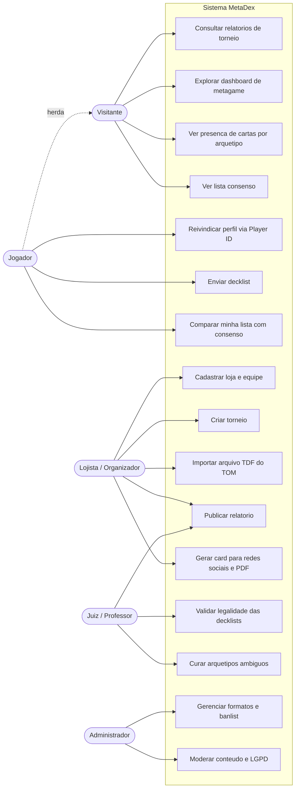

### 3.2 Requisitos Funcionais (RF)

| ID | Requisito | Persona | Prioridade (MoSCoW) |
|---|---|---|---|
| RF-01 | Cadastro de loja com perfil público (nome, cidade, endereço, redes sociais, logo) | Roberto | **Must** |
| RF-02 | Gestão de equipe da loja com papéis (Dono, Staff, Juiz convidado) | Roberto | **Must** |
| RF-03 | Criação de torneio (tipo, formato, data, divisão etária, nº de rodadas, top cut) | Roberto | **Must** |
| RF-04 | Importação do arquivo `.tdf` do TOM (jogadores, rodadas, partidas, *standings*) | Roberto | **Must** |
| RF-05 | Submissão de decklist por texto no formato de exportação do Pokémon TCG Live (PT-BR e EN) | Lucas, Marina | **Must** |
| RF-06 | Validação automática de legalidade (60 cartas, ≤ 4 cópias por nome, 1 ACE SPEC, 1 Radiante, *regulation marks* do formato, banlist) | Ana | **Must** |
| RF-07 | Classificação automática de arquétipo com fila de curadoria manual | Ana | **Must** |
| RF-08 | Página pública do relatório: classificação, arquétipo, decklists (pós-embargo) | Todos | **Must** |
| RF-09 | Dashboard de metagame: *meta share*, conversão para Top Cut, evolução temporal | Lucas | **Must** |
| RF-10 | Taxa de inclusão de cada carta por arquétipo e distribuição de cópias | Marina | **Must** |
| RF-11 | Exportação do relatório em PDF e imagem para redes sociais | Roberto | **Should** |
| RF-12 | Lista consenso (*deck médio*) por arquétipo | Marina | **Should** |
| RF-13 | Matriz de *matchups* (requer *pairings* do TDF) | Lucas | **Should** |
| RF-14 | Perfil de jogador reivindicável por Player ID com histórico | Lucas, Marina | **Should** |
| RF-15 | Upload de decklist em PDF (formulário oficial) com extração via OCR/visão computacional | Ana | **Could** |
| RF-16 | Gerador de decklist oficial em PDF a partir do texto do TCG Live | Marina | **Could** |
| RF-17 | Modo ao vivo: *pairings* e *standings* por rodada via QR Code | Roberto | **Could** |
| RF-18 | Notificações (nova lista de loja seguida, novo relatório) | Lucas | **Could** |
| RF-19 | API pública *read-only* para criadores de conteúdo | Secundária | **Won't (v1)** |
| RF-20 | Sistema de inscrição/pagamento de torneio | — | **Won't (v1)** |

### 3.3 Regras de Negócio (RN)

| ID | Regra |
|---|---|
| RN-01 | Uma decklist só é **legal** se passar por todas as regras do formato vigente na **data do torneio** (não na data atual). |
| RN-02 | Cartas são agrupadas por **equivalência funcional** (reimpressões com mesmo nome e mesmo texto contam como a mesma carta para estatística e para o limite de 4 cópias). |
| RN-03 | **Embargo de decklists:** listas individuais ficam invisíveis ao público até o torneio estar em estado `Encerrado`. Estatísticas agregadas também são bloqueadas durante o evento. |
| RN-04 | O lojista pode escolher a **política de visibilidade**: (a) todas as listas, (b) apenas Top Cut, (c) somente agregados anônimos. |
| RN-05 | Jogadores das divisões Junior e Senior aparecem com nome abreviado (ex.: "Marina S.") por padrão, salvo consentimento do responsável. |
| RN-06 | Alterações em relatório já publicado geram registro imutável em **log de auditoria** (quem, quando, antes/depois). |
| RN-07 | Estatísticas com amostra **n < 5** exibem aviso de baixa significância estatística. |
| RN-08 | Importar o mesmo arquivo `.tdf` duas vezes é **idempotente** (deduplicação por *hash* SHA-256 do conteúdo). |

### 3.4 Requisitos Não Funcionais (RNF) — ISO/IEC 25010

| Característica | ID | Requisito mensurável |
|---|---|---|
| **Eficiência de desempenho** | RNF-01 | LCP < 2,5 s e INP < 200 ms no percentil 75 em rede 4G (Core Web Vitals) |
| | RNF-02 | Importação de torneio com 64 jogadores processada em < 10 s |
| **Confiabilidade** | RNF-03 | Disponibilidade ≥ 99,5% mensal (SLO); RPO ≤ 24 h, RTO ≤ 4 h |
| **Usabilidade** | RNF-04 | SUS ≥ 75; fluxo "publicar torneio" em ≤ 5 cliques após upload |
| **Acessibilidade** | RNF-05 | WCAG 2.2 nível AA; gráficos com paleta segura para daltonismo (Okabe-Ito) e tabela alternativa |
| **Segurança** | RNF-06 | Conformidade OWASP ASVS nível 2; RBAC + *Row-Level Security* no banco |
| **Privacidade** | RNF-07 | Conformidade com LGPD: minimização, base legal por finalidade, direitos do titular atendidos em ≤ 15 dias |
| **Manutenibilidade** | RNF-08 | Cobertura de testes do núcleo de domínio ≥ 85%; complexidade ciclomática ≤ 10 por função |
| **Portabilidade** | RNF-09 | PWA instalável; layout *mobile-first* responsivo de 360 px a 1920 px |
| **Internacionalização** | RNF-10 | i18n preparado para pt-BR (padrão), en e es (expansão LatAm) |
| **SEO** | RNF-11 | Páginas de relatório renderizadas no servidor (SSR/ISR) com dados estruturados (*schema.org/Event*) |

### 3.5 User Stories com Critérios de Aceite (Gherkin/BDD)

**US-04 — Importar arquivo do TOM**
> **Como** lojista, **quero** arrastar o arquivo `.tdf` exportado pelo TOM, **para que** o torneio seja preenchido automaticamente sem digitação.

```gherkin
Funcionalidade: Importação de torneio a partir do TOM

  Cenário: Importação bem-sucedida
    Dado que estou autenticado como organizador da loja "Card House"
    E criei o torneio "League Cup Outubro"
    Quando eu envio um arquivo .tdf válido com 32 jogadores e 6 rodadas
    Então o sistema deve criar 32 inscrições
    E registrar 96 partidas com seus resultados
    E calcular a classificação final com os desempates OWP e OOWP
    E descartar a data de nascimento dos jogadores sem persisti-la

  Cenário: Arquivo duplicado
    Dado que o arquivo "cup_out.tdf" já foi importado
    Quando eu envio o mesmo arquivo novamente
    Então o sistema deve informar "Este arquivo já foi importado"
    E nenhum dado deve ser duplicado
```

**US-06 — Validar decklist**
> **Como** juíza, **quero** que as decklists sejam validadas automaticamente, **para que** eu detecte listas ilegais antes da primeira rodada.

```gherkin
  Cenário: Lista com 5 cópias de uma carta
    Dado uma decklist contendo "3 Ultra Ball SVI 196" e "2 Ultra Ball PAF 91"
    Quando a validação for executada
    Então deve haver a violação "QUATRO_COPIAS" para a carta "Ultra Ball"
    E o status da decklist deve ser "Inválida"

  Cenário: Carta fora do formato
    Dado que o formato Standard da data do torneio aceita as marcas "G", "H" e "I"
    E a decklist contém uma carta com marca de regulação "F"
    Então deve haver a violação "FORA_DO_FORMATO"
```

**US-10 — Presença de cartas**
> **Como** jogadora iniciante, **quero** ver a porcentagem de listas de um arquétipo que usam cada carta, **para que** eu priorize minhas compras.

```gherkin
  Cenário: Exibir taxa de inclusão
    Dado 20 decklists classificadas como "Gardevoir ex" no período selecionado
    E 19 delas contêm ao menos 1 "Ultra Ball"
    Quando eu acesso a página do arquétipo "Gardevoir ex"
    Então devo ver "Ultra Ball" com taxa de inclusão de 95%
    E a média de cópias entre as listas que a utilizam
    E um histograma com a distribuição de 1, 2, 3 e 4 cópias
```

### 3.6 Definition of Ready (DoR) e Definition of Done (DoD)

| DoR (história pode entrar na sprint) | DoD (história está pronta) |
|---|---|
| Critérios de aceite em Gherkin | Código revisado (*code review* por ≥ 1 par) |
| Estimada (*story points*, Fibonacci) | Testes unitários + integração passando no CI |
| Dependências identificadas | Acessibilidade verificada (axe-core sem erros) |
| Protótipo de UI aprovado (se aplicável) | Eventos de analytics instrumentados |
| Atende ao INVEST | Documentação/ADR atualizado; deploy em *staging* |

---

## Fase 4 — Modelagem de Domínio (DDD + UML)

### 4.1 Linguagem Ubíqua (Glossário)

| Termo | Definição no domínio |
|---|---|
| **Torneio** | Evento sancionado (League Challenge, League Cup, etc.) com rodadas suíças e, opcionalmente, Top Cut |
| **Inscrição** | Participação de um Jogador em um Torneio (agregado que contém a decklist e o resultado) |
| **Decklist** | Conjunto de exatamente 60 cartas submetido para um torneio |
| **Carta Canônica** | Identidade funcional de uma carta, agrupando todas as suas reimpressões |
| **Arquétipo** | Estratégia de deck identificada por cartas-assinatura (ex.: "Charizard ex / Pidgeot ex") |
| **Meta Share** | Participação percentual de um arquétipo no total de decklists |
| **Taxa de Conversão** | Razão entre a participação no Top Cut e a participação no torneio |
| **Taxa de Inclusão** | Percentual de listas de um arquétipo que contêm ao menos uma cópia de uma carta |
| **Lista Consenso** | Lista sintética de 60 cartas que representa o "deck médio" de um arquétipo |
| **Formato** | Conjunto de regras de legalidade vigente em um intervalo de datas (Standard, Expanded) |
| **Embargo** | Período em que decklists individuais ficam ocultas |

### 4.2 Context Map (Bounded Contexts)

Arquitetura em **Monólito Modular**: cada *Bounded Context* é um módulo com fronteiras explícitas, comunicando-se por **eventos de domínio** internos. Isso permite extrair microsserviços no futuro sem reescrita (*Strangler Fig Pattern*).

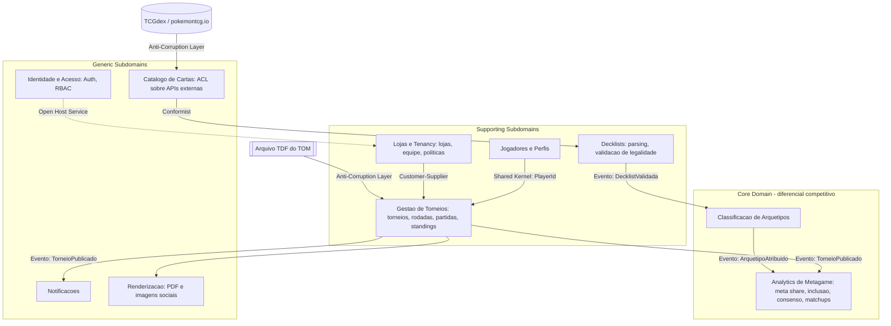

**Agregados e invariantes principais:**

| Agregado (raiz) | Invariantes protegidas |
|---|---|
| `Torneio` | Transições de estado válidas (ver 4.5); partidas pertencem a rodadas existentes; não publica sem *standings* |
| `Decklist` | Soma de quantidades = 60; limite de cópias por carta canônica; imutável após `Aprovada` (nova versão em vez de edição) |
| `Loja` | Sempre ≥ 1 membro com papel Dono |
| `Arquetipo` | Regras de assinatura não ambíguas (prioridade única) |

### 4.3 Modelo Entidade-Relacionamento (Lógico)

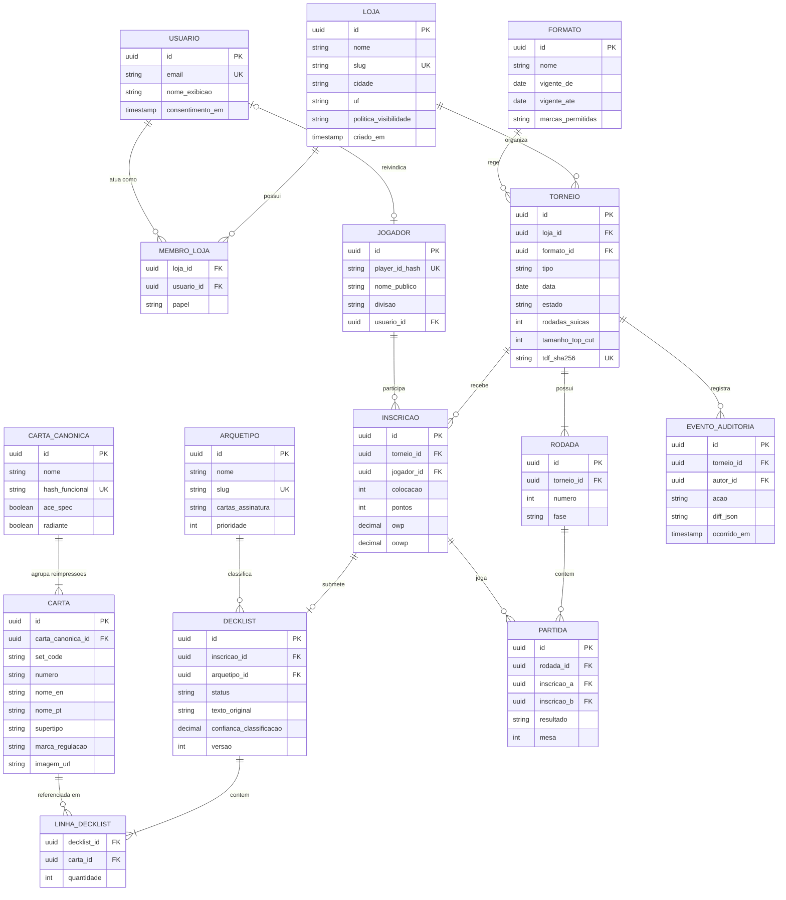

> **Decisões de modelagem:**
> - `player_id_hash`: o Player ID (POP ID) é armazenado como **hash com *salt*** (HMAC-SHA-256) — permite *matching* entre torneios sem expor o identificador (pseudonimização, LGPD Art. 13 §4º).
> - `CARTA_CANONICA.hash_funcional`: hash de `nome + texto de ataques/habilidades` — resolve reimpressões (RN-02).
> - `DECKLIST.versao`: *event-sourcing light* — correções criam nova versão, preservando histórico.

### 4.4 Diagrama de Classes — Núcleo de Validação e Classificação

Aplicação dos padrões **Strategy** (regras plugáveis), **Composite** (classificador composto) e **Specification** (regras de legalidade).

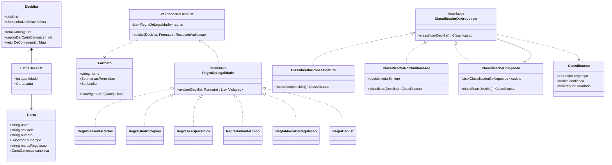

### 4.5 Máquina de Estados — Ciclo de Vida do Torneio

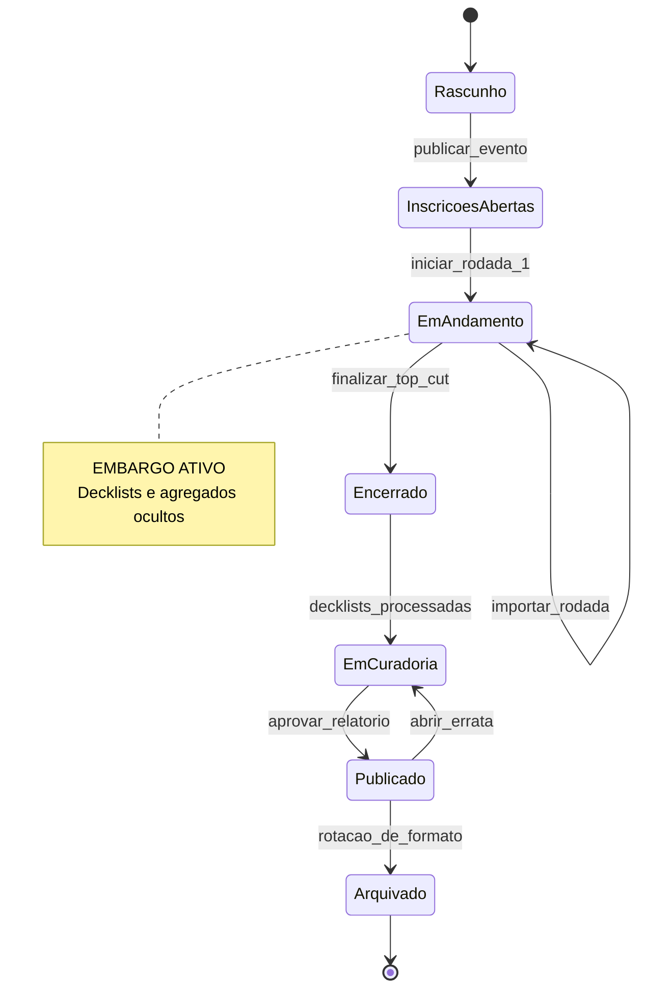

### 4.6 Máquina de Estados — Decklist

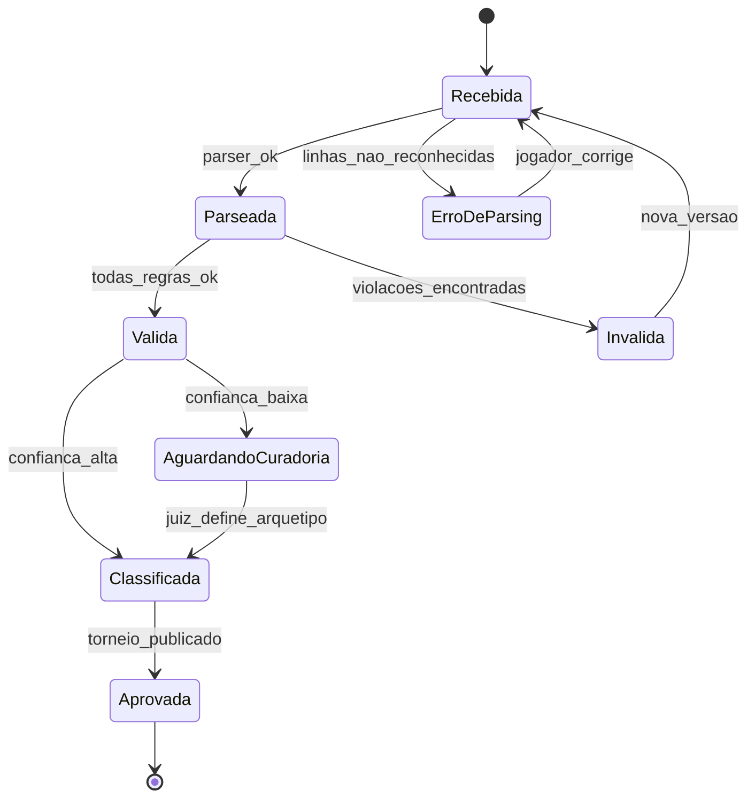

---

## Fase 5 — Arquitetura de Solução (C4 + ADRs)

### 5.1 C4 — Nível 1: Diagrama de Contexto

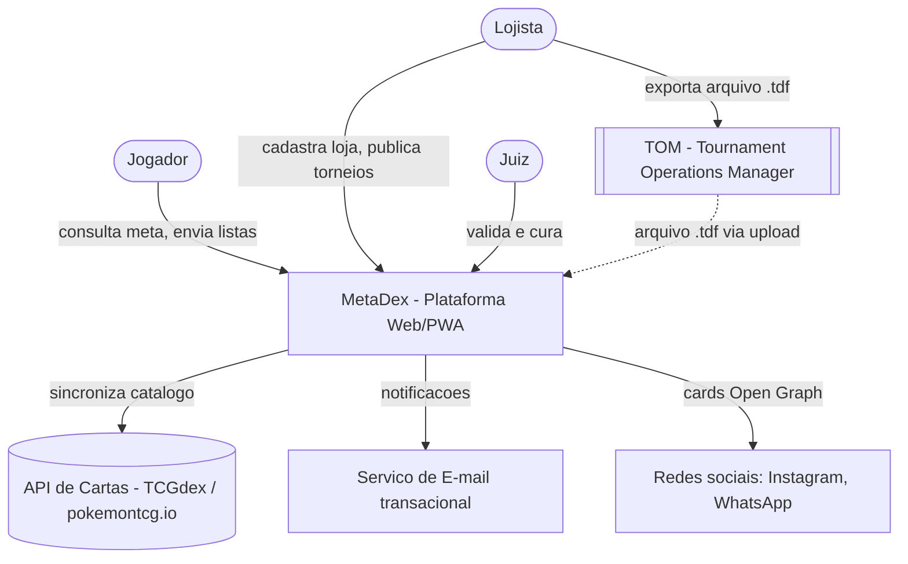

### 5.2 C4 — Nível 2: Diagrama de Containers

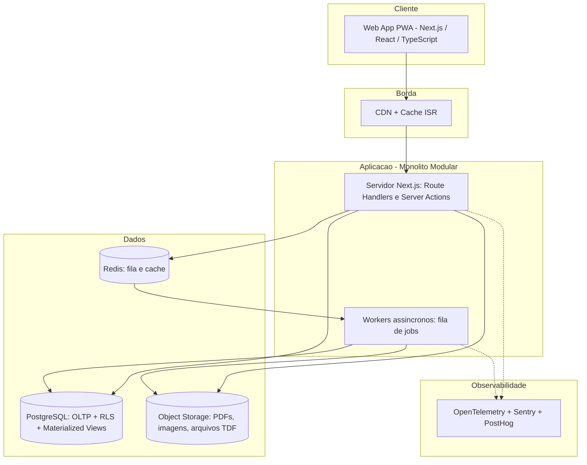

### 5.3 Stack Tecnológica Recomendada

| Camada | Tecnologia | Justificativa |
|---|---|---|
| Linguagem | **TypeScript** (ponta a ponta) | Tipagem estática compartilhada entre front, back e parsers; um único *skill set* |
| Front-end / BFF | **Next.js (App Router)** + React Server Components | SSR/ISR para SEO dos relatórios; Server Actions reduzem *boilerplate* de API |
| UI | **Tailwind CSS** + **shadcn/ui** (Radix) | Componentes acessíveis por padrão; *design tokens* |
| Gráficos | **Apache ECharts** (ou Nivo) | Treemap, Sankey, heatmap e *stacked area* nativos; boa performance mobile |
| ORM / Migrações | **Drizzle ORM** (ou Prisma) | *Type-safe SQL*, migrações versionadas |
| Banco | **PostgreSQL** (Supabase ou Neon) | Relacional + JSONB + *Materialized Views* + *Row-Level Security* para multi-tenancy |
| Fila | **BullMQ** sobre Redis (ou Inngest) | Jobs de parsing, OCR, agregação e renderização de PDF com *retry* exponencial |
| Auth | **Supabase Auth** ou **Auth.js** | OAuth (Google/Discord) + *magic link*; integra com RLS |
| PDF | **Playwright/Chromium headless** ou `@react-pdf/renderer` | PDF fiel ao layout do relatório |
| Imagens sociais | **Satori / `@vercel/og`** | Geração de cards Open Graph em *edge* |
| OCR de PDF | Extração de campos AcroForm → fallback **LLM multimodal** com saída estruturada (JSON Schema) | Formulário oficial preenchível é parseado deterministicamente; escaneados vão para visão computacional com confirmação humana |
| Validação de esquema | **Zod** | Contratos de entrada validados em tempo de execução |
| Hosting | **Vercel** (app) + Supabase/Neon (dados) + Cloudflare R2 (storage) | *Serverless*, custo inicial ~zero, escala sob demanda |

### 5.4 Architecture Decision Records (ADRs)

| ADR | Decisão | Contexto | Alternativas rejeitadas | Consequências |
|---|---|---|---|---|
| ADR-001 | **Monólito modular** em vez de microsserviços | Equipe pequena, domínio ainda em descoberta | Microsserviços (complexidade operacional prematura) | Deploy único; fronteiras por módulo com *lint* de dependências (`eslint-plugin-boundaries`) |
| ADR-002 | **PostgreSQL com RLS** para multi-tenancy (tenant = loja) | Isolamento de dados por loja com baixo custo | Banco por tenant (custo); filtragem só na aplicação (risco de vazamento) | Política RLS obrigatória em toda tabela com `loja_id` |
| ADR-003 | **CQRS-lite**: escrita normalizada, leitura via *Materialized Views* | Consultas analíticas pesadas sobre dados que mudam pouco | OLAP separado (ClickHouse/BigQuery) — prematuro | `REFRESH MATERIALIZED VIEW CONCURRENTLY` disparado pelo evento `TorneioPublicado` |
| ADR-004 | **Anti-Corruption Layer** sobre APIs de cartas | APIs externas mudam; nomes PT-BR vs EN | Acoplamento direto | Catálogo próprio sincronizado por job diário; app funciona se a API cair |
| ADR-005 | **Classificador de arquétipo híbrido** (regras + similaridade + humano) | Precisão alta é crítica para confiança no produto | ML puro (pouco dado rotulado inicialmente) | *Human-in-the-loop*; rótulos da curadoria viram dataset para evolução |
| ADR-006 | **Minimização de dados do TDF** | Arquivo contém data de nascimento | Persistir tudo | Data de nascimento descartada em memória; apenas divisão etária é mantida |

---

## Fase 6 — Pipeline de Dados & Motor Analítico

### 6.1 Fluxo ETL/ELT de Ingestão

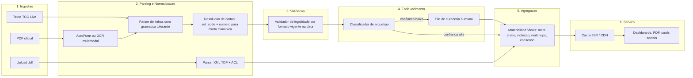

### 6.2 Diagrama de Sequência — Publicação de Torneio

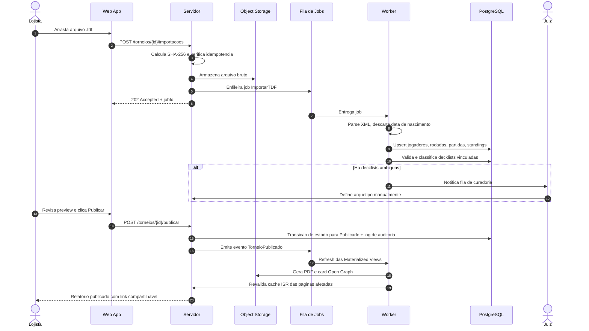

### 6.3 Parser de Decklist (Formato TCG Live)

Entrada típica:
```text
Pokémon: 15
3 Charizard ex OBF 125
2 Pidgeot ex OBF 164
...
Trainer: 33
4 Rare Candy SVI 191
...
Energy: 12
6 Basic {R} Energy SVE 2
```

**Estratégia:** gramática tolerante (*lenient parsing*) com expressão regular por linha e *fallbacks*:

```text
LINHA      := QUANTIDADE ESPACO NOME ESPACO SET_CODE ESPACO NUMERO
QUANTIDADE := [1-9][0-9]?
SET_CODE   := [A-Z0-9-]{2,6}          (ex.: OBF, SVI, PR-SV)
NUMERO     := [0-9]+[a-zA-Z]?
CABECALHO  := ("Pokémon" | "Trainer" | "Treinador" | "Energy" | "Energia") ":" QUANTIDADE
```

- **Resolução de cartas:** chave primária `(set_code, numero)`; *fallback* por nome com **distância de Levenshtein/Jaro-Winkler** para erros de digitação; nomes PT-BR mapeados via catálogo multilíngue (TCGdex).
- **Relatório de parsing:** cada linha não reconhecida é devolvida ao usuário com sugestão (*"Você quis dizer 'Ultra Ball SVI 196'?"*).

### 6.4 Classificação de Arquétipos (Híbrida)

1. **Classificador por Assinatura (determinístico):** cada arquétipo define um conjunto de cartas-assinatura e uma prioridade. Ex.: `Charizard ex` + `Pidgeot ex` → "Charizard Pidgeot". Primeira regra satisfeita por ordem de prioridade vence.
2. **Classificador por Similaridade (estatístico):** representa cada decklist como vetor de contagens $\mathbf{v}_d \in \mathbb{N}^{|C|}$ sobre o espaço de cartas canônicas e compara com o **centroide** de cada arquétipo usando **similaridade de Jaccard ponderada**:

$$
J_w(\mathbf{a}, \mathbf{b}) = \frac{\sum_{c} \min(a_c, b_c)}{\sum_{c} \max(a_c, b_c)}
$$

   Se $\max_A J_w(\mathbf{v}_d, \boldsymbol{\mu}_A) < \tau$ (limiar, ex.: 0,55), a lista vai para **curadoria humana**.
3. **Human-in-the-loop:** o juiz rotula; o rótulo realimenta os centroides (*active learning*).
4. **Evolução (v2):** clusterização não supervisionada (**HDBSCAN** sobre vetores de cartas) para **descobrir arquétipos emergentes** ("rogue decks") automaticamente.

### 6.5 Fórmulas do Motor Analítico

Seja $D$ o conjunto de decklists no recorte (período, região, loja, formato), $D_A \subseteq D$ as listas do arquétipo $A$, e $q_d(c)$ a quantidade da carta canônica $c$ na lista $d$.

**Meta Share (participação):**
$$
\text{MS}(A) = \frac{|D_A|}{|D|}
$$

**Taxa de Conversão para Top Cut** (valores > 1 indicam arquétipo sobre-representado entre os melhores):
$$
\text{CR}(A) = \frac{|T_A| \,/\, |T|}{|D_A| \,/\, |D|}
$$
onde $T$ é o conjunto de listas no Top Cut.

**Win Rate** (empate valendo 1/3, coerente com a pontuação 3-1-0):
$$
\text{WR}(A) = \frac{3W + T}{3\,(W + L + T)}
$$

**Taxa de Inclusão de Carta** (a "porcentagem de presença" pedida):
$$
\text{IR}(c, A) = \frac{\left|\{ d \in D_A : q_d(c) > 0 \}\right|}{|D_A|}
$$

**Média Condicional de Cópias** (média só entre as listas que usam a carta):
$$
\bar{q}(c, A) = \frac{\sum_{d \in D_A} q_d(c)}{\left|\{ d \in D_A : q_d(c) > 0 \}\right|}
$$

**Inclusão Ponderada por Desempenho** (listas melhor colocadas pesam mais — inspirado em DCG):
$$
\text{IR}_w(c, A) = \frac{\sum_{d \in D_A} w_d \cdot \mathbb{1}[q_d(c) > 0]}{\sum_{d \in D_A} w_d}, \qquad w_d = \frac{1}{\log_2(1 + \text{rank}_d)}
$$

**Intervalo de Confiança de Wilson** (exibido como barra de erro; essencial em amostras pequenas de loja):
$$
\frac{\hat{p} + \frac{z^2}{2n} \pm z\sqrt{\frac{\hat{p}(1-\hat{p})}{n} + \frac{z^2}{4n^2}}}{1 + \frac{z^2}{n}}, \qquad z = 1{,}96
$$

**Suavização Bayesiana do Win Rate** (evita que um arquétipo com 2-0 apareça com 100%):
$$
\widetilde{\text{WR}}(A) = \frac{\text{pontos}_A + k \cdot \overline{\text{WR}}}{\text{partidas}_A + k}
$$
com $k$ (ex.: 10) atuando como *prior* em direção à média global.

**Algoritmo da Lista Consenso (guloso):**
1. Para cada carta $c$ com $\text{IR}(c, A) \geq 0{,}5$, calcular a **moda** de cópias entre listas que a usam.
2. Ordenar por $\text{IR}$ decrescente e adicionar com a quantidade modal.
3. Se total < 60, completar com cartas de maior $\text{IR}$ abaixo de 0,5 (*flex slots*); se > 60, reduzir cópias das cartas de menor $\text{IR}$.
4. Rodar o **validador de legalidade** sobre o resultado (a lista consenso também precisa ser legal).
5. Marcar visualmente: **Core** ($\text{IR} \geq 0{,}9$), **Padrão** ($0{,}5 \leq \text{IR} < 0{,}9$), **Tech/Flex** ($< 0{,}5$).

**Exemplo ilustrativo (dados fictícios)** — arquétipo "Charizard Pidgeot", $n = 24$:

| Carta | Inclusão | Média cópias | Distribuição 1/2/3/4 | Classe |
|---|---|---|---|---|
| Rare Candy | 100% | 4,0 | 0 / 0 / 0 / 24 | Core |
| Charizard ex | 100% | 2,8 | 0 / 5 / 19 / 0 | Core |
| Pidgeot ex | 96% | 1,9 | 3 / 20 / 0 / 0 | Core |
| Super Rod | 71% | 1,1 | 15 / 2 / 0 / 0 | Padrão |
| Lost Vacuum | 29% | 1,0 | 7 / 0 / 0 / 0 | Tech |

### 6.6 Sequência — Consulta de Inclusão de Cartas (caminho de leitura)

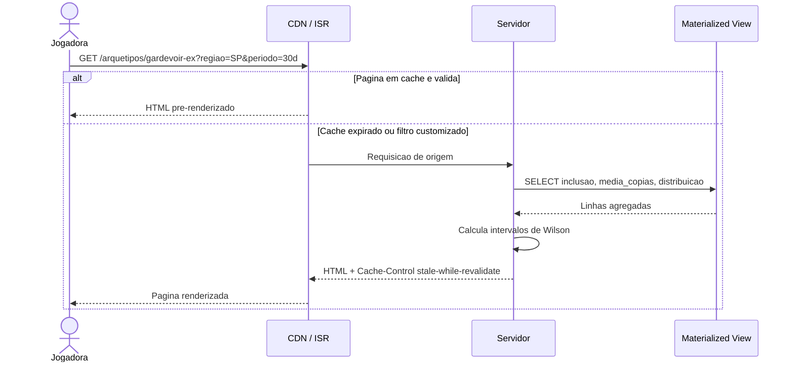

---

## Fase 7 — UX/UI e Visualização de Dados

### 7.1 Arquitetura de Informação (Sitemap)

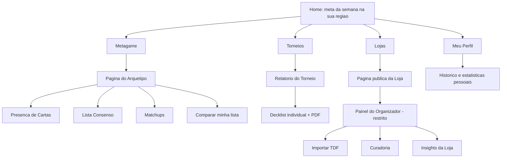

### 7.2 Catálogo de Visualizações (Gráfico certo para a pergunta certa)

| Pergunta do usuário | Visualização | Justificativa (princípios de Tufte/Cleveland) |
|---|---|---|
| "O que está sendo jogado?" | **Barras horizontais ordenadas** (ou Treemap) | Comparação de comprimento é mais precisa que ângulo (evitar pizza com > 5 fatias) |
| "Como o meta mudou?" | **Área empilhada 100%** ao longo das semanas | Mostra composição e tendência simultaneamente |
| "Quem converte melhor?" | **Gráfico de dispersão**: meta share (x) × conversão (y), tamanho = n | Identifica "decks sub-representados e fortes" no quadrante superior esquerdo |
| "Contra o que meu deck vai bem?" | **Heatmap de matchups** com escala divergente centrada em 50% | Padrão consolidado em analytics de TCG; células com n baixo esmaecidas |
| "Que cartas preciso?" | **Barras de inclusão + histograma de cópias** (*small multiples*) | Responde "se" e "quantas" ao mesmo tempo |
| "Como foi o torneio?" | **Sankey**: arquétipos no Swiss → Top Cut → Campeão | Narrativa visual de funil |
| "Minha evolução?" | **Linha temporal** de colocação percentual + *sparklines* | Contexto histórico compacto |

**Exemplo ilustrativo (dados fictícios):**

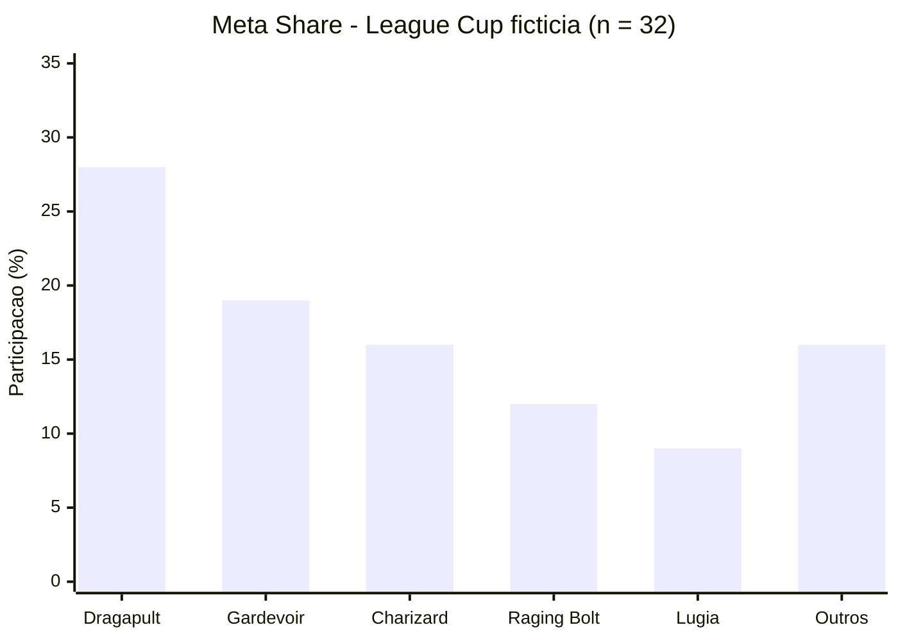

### 7.3 Diretrizes de Design
- **Mobile-first**: 80%+ do tráfego esperado vem de celular (Lucas e Marina).
- **Progressive disclosure**: Marina vê "Cartas essenciais"; Lucas expande para intervalos de confiança e filtros avançados.
- **Insights em linguagem natural** para Roberto: *"Dragapult cresceu 12 p.p. nas suas últimas 4 Cups."*
- **Design system com *design tokens*** (cores por tipo de energia como acento, sem usar marcas registradas).
- **Estados vazios e de erro desenhados** (*empty states* educativos: "Ainda não há torneios nesta loja — convide o organizador").
- **Card social compartilhável** (1080×1350 para feed, 1080×1920 para stories) com Top 8 e ícones dos arquétipos.

### 7.4 Validação de UX
- Teste de usabilidade moderado (5 usuários por persona — heurística de Nielsen).
- Métricas: **SUS**, *Task Success Rate*, *Time on Task* (publicar torneio < 5 min).
- Avaliação heurística (10 heurísticas de Nielsen) antes de cada release.

---

## Fase 8 — Qualidade, Testes e Segurança

### 8.1 Pirâmide de Testes

| Nível | Ferramenta | Escopo | Meta |
|---|---|---|---|
| **Unitário** | Vitest | Regras de legalidade, fórmulas, classificador | ≥ 85% do domínio |
| **Property-based** | fast-check | Invariantes: "lista válida sempre soma 60", "IR ∈ [0,1]", "parser(serializar(x)) = x" (*round-trip*) | Geradores de decklists aleatórias |
| **Golden files / Snapshot** | Vitest | Arquivos `.tdf` e decklists reais anonimizadas → saída esperada | 1 *fixture* por variação de TOM conhecida |
| **Integração** | Testcontainers (PostgreSQL real) | Repositórios, RLS, Materialized Views | Toda política RLS testada (positivo e negativo) |
| **Contrato** | Zod + testes de esquema | ACL das APIs de cartas | Detecta *breaking changes* externos |
| **E2E** | Playwright | Fluxos críticos: publicar torneio, enviar lista, consultar meta | Caminhos felizes + 1 erro por fluxo |
| **Regressão visual** | Playwright screenshots | Gráficos e PDF | Diff de pixel controlado |
| **Carga** | k6 | Pico pós-torneio (muitos acessos simultâneos ao relatório) | p95 < 500 ms com 500 RPS |
| **Acessibilidade** | axe-core + Lighthouse CI | Todas as páginas públicas | Zero violações críticas |

### 8.2 Threat Modeling (STRIDE)

| Ameaça | Cenário | Mitigação |
|---|---|---|
| **S**poofing | Alguém reivindica o Player ID de outro jogador | Reivindicação exige confirmação do organizador ou código enviado pela loja |
| **T**ampering | Lojista altera resultado após publicação | Log de auditoria imutável (RN-06); *diff* público de erratas |
| **R**epudiation | "Eu não alterei esse resultado" | Auditoria com autor, IP e *timestamp* |
| **I**nformation Disclosure | Vazamento de lista durante o torneio (scouting) | Embargo aplicado **no banco** (RLS por estado do torneio), não só na UI |
| **D**enial of Service | Upload massivo de arquivos | *Rate limiting* por usuário/IP; limite de tamanho; processamento assíncrono |
| **E**levation of Privilege | Staff de uma loja acessando outra loja | RLS por `loja_id` + testes negativos automatizados |

Além disso: **OWASP Top 10** (validação de XML contra **XXE** no parser do TDF — desabilitar entidades externas!), CSP restritiva, *secrets* em cofre, dependências auditadas (Dependabot/Renovate + `npm audit`).

### 8.3 Privacidade & LGPD
- **RIPD** (Relatório de Impacto à Proteção de Dados) antes do lançamento — há tratamento de dados de **crianças e adolescentes**.
- **Bases legais:** execução de contrato (conta), legítimo interesse (resultados públicos de evento, com LIA documentado), **consentimento específico do responsável** para menores (Art. 14).
- **Minimização:** data de nascimento do TDF descartada; Player ID pseudonimizado.
- **Direitos do titular:** autoatendimento para exportar/excluir dados; opção de anonimizar histórico.
- **Disclaimer de IP:** "Projeto de fã não oficial. Pokémon e seus elementos são marcas de Nintendo, Creatures, GAME FREAK e The Pokémon Company." — sem uso de logotipos oficiais.

---

## Fase 9 — CI/CD, Deploy e Observabilidade

### 9.1 Pipeline de Entrega Contínua

```mermaid
flowchart LR
    DEV["Commit - Conventional Commits"] --> PR["Pull Request"]
    PR --> CI1["Lint + Typecheck"]
    CI1 --> CI2["Testes unitarios e property-based"]
    CI2 --> CI3["Testes de integracao - Testcontainers"]
    CI3 --> CI4["SAST + audit de dependencias"]
    CI4 --> PREV["Preview Deploy por PR"]
    PREV --> E2E["E2E Playwright + Lighthouse CI"]
    E2E --> REV["Code Review + aprovacao"]
    REV --> MAIN["Merge na main - trunk-based"]
    MAIN --> MIG["Migracoes expand-contract"]
    MIG --> STG["Staging"]
    STG --> SMOKE["Smoke tests"]
    SMOKE --> PROD["Producao com feature flags"]
    PROD --> MON["Monitoramento de SLO"]
    MON -->|"error budget estourado"| RB["Rollback automatico"]
```

**Práticas:** *trunk-based development*, *feature flags* para liberar funcionalidades por loja (*canary* por tenant), versionamento semântico, *changelog* gerado automaticamente, migrações de banco no padrão **expand/contract** (zero downtime).

### 9.2 Observabilidade (Três Pilares + Produto)

| Pilar | Ferramenta | O que medir |
|---|---|---|
| **Logs** estruturados | Pino → agregador | `jobId`, `torneioId`, `lojaId` (correlação) |
| **Métricas** | OpenTelemetry | Duração de import, taxa de falha de parsing, profundidade da fila |
| **Traces** distribuídos | OpenTelemetry | Upload → worker → refresh de views |
| **Erros** | Sentry | Exceções com contexto de release |
| **Produto** | PostHog | Funis, retenção, *feature adoption* |

**SLOs iniciais:** disponibilidade 99,5%; 95% das importações concluídas em < 30 s; taxa de parsing automático de decklists ≥ 97%.

---

## Fase 10 — Métricas de Produto e Go-to-Market

### 10.1 North Star Metric
> **"Número de torneios publicados por semana com ≥ 80% das decklists processadas."**

Captura simultaneamente **oferta** (lojas ativas), **qualidade dos dados** (listas completas) e alimenta diretamente o valor para o jogador (meta mais confiável).

### 10.2 Funil AARRR (Pirate Metrics)

| Etapa | Jogador | Lojista |
|---|---|---|
| **Aquisição** | Acesso via card compartilhado no Instagram/WhatsApp | Indicação de juiz / outra loja |
| **Ativação** | Visualizou ≥ 1 página de arquétipo | Publicou o 1º torneio |
| **Retenção** | Retorno semanal (coorte W1, W4) | Publicou ≥ 3 torneios em 4 semanas |
| **Receita** | (futuro) Plano Premium: alertas, comparador avançado | Plano Loja Pro: branding, insights de público, remoção de marca d'água |
| **Referência** | Compartilhou relatório/lista | Convidou outra loja |

### 10.3 Estratégia de Lançamento
1. **Alpha fechado:** o juiz criador do protótipo + 2–3 lojas parceiras (*concierge onboarding*).
2. **Beta regional:** uma cidade/estado — densidade de dados importa mais que alcance (efeito de rede local).
3. **Expansão:** estados vizinhos; parcerias com comunidades de Discord e criadores de conteúdo.

---

## 11. Roadmap Incremental

```mermaid
flowchart LR
    subgraph S0["Sprint 0 - Fundacao"]
        A0["Repo, CI, design system base, ADRs, esquema do banco, spike TDF"]
    end
    subgraph MVP["v0.1 MVP - 6 semanas"]
        A1["Cadastro de loja e torneio"]
        A2["Import TDF"]
        A3["Decklist por texto + validacao"]
        A4["Classificacao por assinatura + curadoria"]
        A5["Relatorio publico + meta share"]
        A6["Presenca de cartas por arquetipo"]
    end
    subgraph V02["v0.2 - Analytics"]
        B1["Lista consenso"]
        B2["Matriz de matchups"]
        B3["Evolucao temporal e filtros regionais"]
        B4["PDF e cards sociais"]
    end
    subgraph V03["v0.3 - Engajamento"]
        C1["Perfil de jogador por Player ID"]
        C2["Comparador minha lista vs consenso"]
        C3["Upload de PDF com OCR"]
        C4["PWA + notificacoes"]
    end
    subgraph V10["v1.0 - Escala"]
        D1["Modo ao vivo por rodada"]
        D2["Insights da loja e plano Pro"]
        D3["Clusterizacao de arquetipos emergentes"]
        D4["API publica e i18n LatAm"]
    end
    S0 --> MVP --> V02 --> V03 --> V10
```

### Story Map do MVP (fatia vertical mínima)

| Backbone → | Cadastrar | Importar | Processar listas | Publicar | Consumir |
|---|---|---|---|---|---|
| **MVP** | Loja + 1 organizador | Upload `.tdf` | Colar texto TCG Live; validar; classificar por regra | Botão publicar + embargo | Relatório, meta share, presença de cartas |
| **v0.2** | Equipe com papéis | Re-import por rodada | Similaridade + curadoria | PDF + card social | Consenso, matchups, tendência |
| **v0.3** | Perfil público da loja | — | Upload PDF/OCR | Errata com auditoria | Perfil de jogador, comparador |

---

## 12. Matriz de Riscos

| Risco | Prob. | Impacto | Estratégia | Ação |
|---|---|---|---|---|
| Baixa adesão de lojistas (atrito de uso) | Alta | Crítico | Mitigar | Import em 1 arquivo; *concierge onboarding*; juiz como embaixador |
| Jogadores não enviam decklists | Média | Alto | Mitigar | Coleta integrada ao *check-in* via QR Code; lojista pode exigir |
| Formato do `.tdf` muda entre versões do TOM | Média | Alto | Mitigar | ACL isolada + *golden files* por versão + alertas de falha de parsing |
| Classificação de arquétipo imprecisa | Média | Alto | Mitigar | Híbrido + curadoria humana + métrica de precisão monitorada |
| Questões de propriedade intelectual (TPCi) | Baixa | Crítico | Evitar | Sem logos oficiais; disclaimer; imagens de cartas via API com atribuição; postura de projeto de fã |
| Não conformidade LGPD com menores | Média | Crítico | Evitar | RIPD, consentimento parental, nome abreviado por padrão |
| Scouting durante o torneio | Média | Médio | Evitar | Embargo forçado por RLS no banco |
| Amostras pequenas geram conclusões erradas | Alta | Médio | Mitigar | Intervalos de Wilson, suavização bayesiana, avisos de n baixo |
| Custo de infraestrutura com crescimento | Baixa | Médio | Aceitar/monitorar | ISR/CDN para leituras; Materialized Views; alertas de custo |

---

## 13. Próximos Passos Imediatos

1. **Obter o HTML do colega** e 3–5 arquivos `.tdf` reais (anonimizados) → engenharia reversa e *spike* de parsing (valida H4).
2. **Agendar entrevistas** (Fase 1) usando as personas deste documento como hipóteses a serem confirmadas ou refutadas.
3. **Montar landing page** de captura de interesse (valida H1).
4. **Sprint 0:** inicializar repositório (Next.js + TypeScript + Drizzle + PostgreSQL), CI no GitHub Actions, registrar ADR-001 a ADR-006.
5. **Implementar primeiro o núcleo de domínio puro** (parser + validador + fórmulas) com testes — é a parte de maior valor e menor dependência de infraestrutura.

---

*Documento vivo — versionado junto ao código. Toda decisão relevante deve gerar um ADR em `docs/adr/`.*
